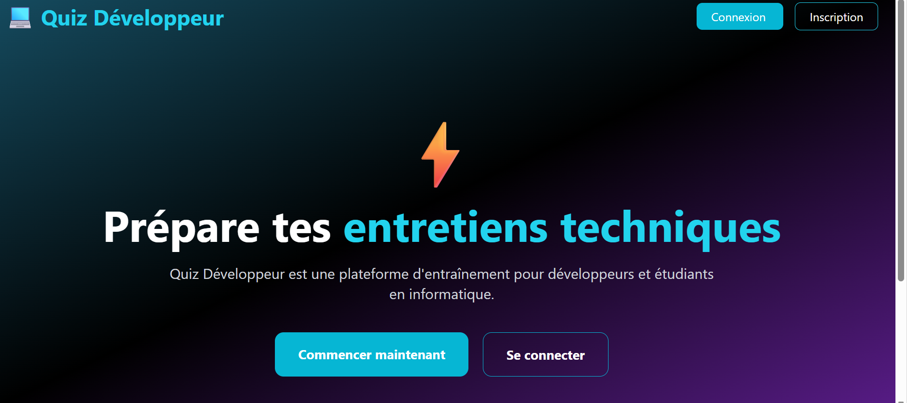
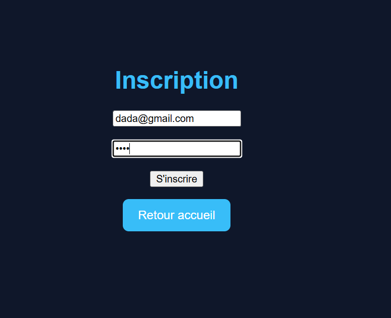
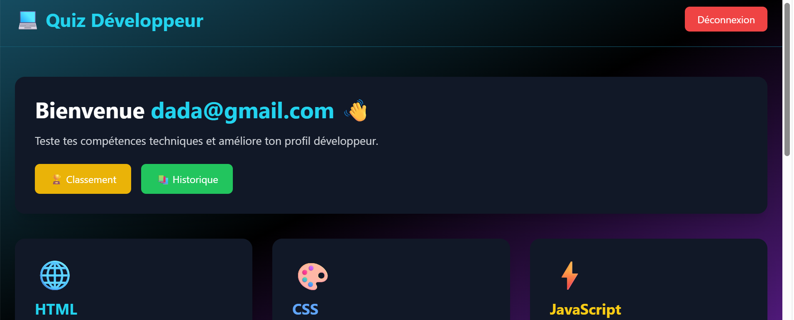
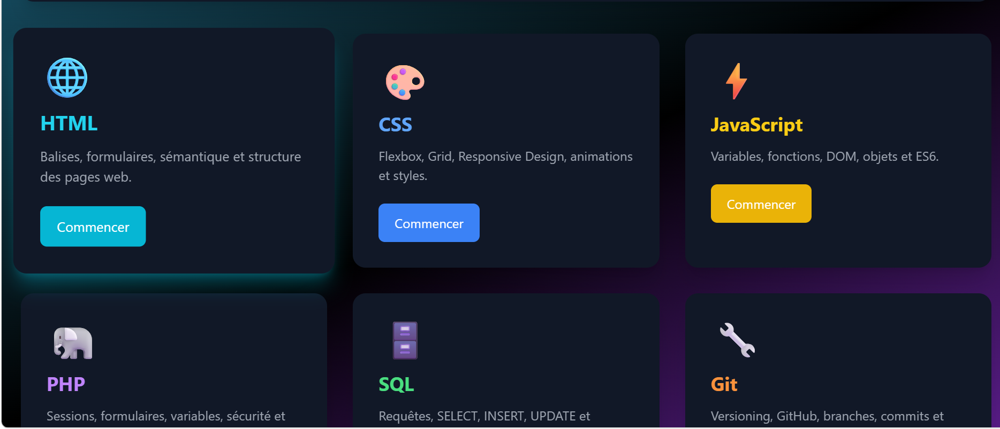
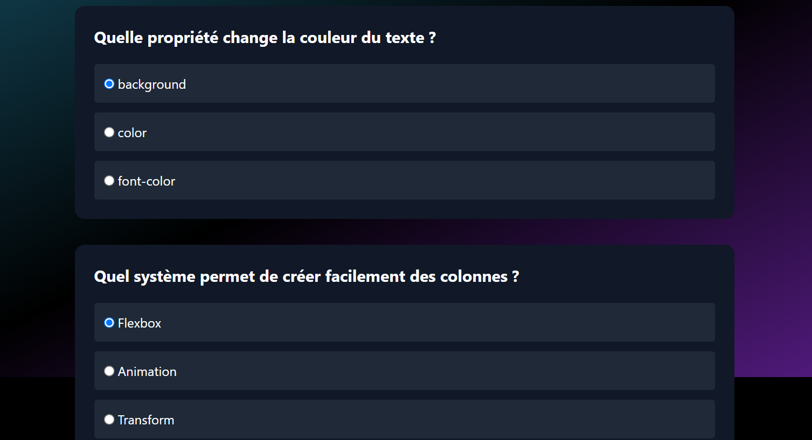
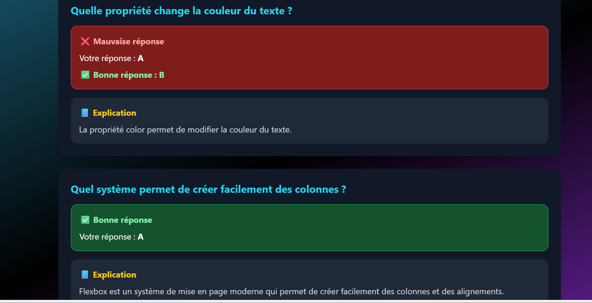

# 💻 Quiz Développeur

Application web PHP/MySQL permettant aux développeurs et étudiants en informatique de tester leurs connaissances grâce à des quiz interactifs.

Les utilisateurs peuvent créer un compte, se connecter, répondre à des quiz, consulter leurs résultats et suivre leur progression.

---

## ✨ Fonctionnalités

- ✅ Inscription utilisateur
- ✅ Connexion sécurisée
- ✅ Sessions PHP
- ✅ Quiz interactifs
- ✅ Questions à choix multiples
- ✅ Calcul automatique du score
- ✅ Explications après chaque réponse
- ✅ Historique des résultats
- ✅ Classement des utilisateurs
- ✅ Base de données MySQL

---

## 📸 Captures d'écran

### 🏠 Accueil



### 🔐 Connexion



### 📝 Inscription



### 🎯 Quiz



### ❓ Question



### 🏆 Résultat


### 📖 Explication



---

## 🛠 Technologies utilisées

### Frontend

- HTML5
- CSS3
- JavaScript

### Backend

- PHP 8

### Base de données

- MySQL

### Outils

- Git
- GitHub
- VS Code

---

## 🏗 Architecture

```text
Navigateur
     │
     ▼
Application PHP
     │
     ▼
Base de données MySQL
```

---

## 📂 Structure du projet

```text
recruteur-ai/
│
├── assets/
├── css/
├── js/
├── includes/
├── database/
│   └── recruteur_ai.sql
│
├── screenshots/
│   ├── home-quiz.png
│   ├── login.png
│   ├── register.png
│   ├── quiz.png
│   ├── question.png
│   ├── result.png
│   └── explanation.png
│
├── index.php
├── login.php
├── register.php
├── quiz.php
├── play_quiz.php
├── result.php
├── leaderboard.php
├── history.php
├── logout.php
└── README.md
```

---

## 🚀 Installation

### 1. Cloner le projet

```bash
git clone https://github.com/ddoghmane/recruteur-ai.git
```

### 2. Entrer dans le dossier

```bash
cd recruteur-ai
```

### 3. Créer la base de données

```sql
CREATE DATABASE recruteur_ai;
```

### 4. Importer la base

```bash
mysql -u root -p recruteur_ai < database/recruteur_ai.sql
```

### 5. Lancer le serveur PHP

```bash
php -S localhost:8000
```

### 6. Ouvrir dans le navigateur

```text
http://localhost:8000
```

---

## 🗄 Base de données

### Export

```bash
mysqldump -u root -p recruteur_ai > database/recruteur_ai.sql
```

### Import

```bash
mysql -u root -p recruteur_ai < database/recruteurAuthentification utilisateur
- Conception de base de données
- SQL et MySQL
- Architecture web
- Manipulation de formulaires
- Gestion des scores
- Interface utilisateur
- Git et GitHub

---

## 📈 Évolutions possibles

- Ajout de nouvelles catégories de quiz
- Tableau de bord administrateur
- Système de badges
- Classement avancé
- API REST
- Application mobile Flutter
- Authentification OAuth (Google/GitHub)

---

## 👨‍💻 Auteur

**Daoud Doghmane**

GitHub :  
https://github.com/ddoghmane

---

## 📜 Licence

Projet personnel réalisé dans le cadre de l'apprentissage du développement web avec PHP et MySQL.

Libre d'utilisation à des fins éducatives.
